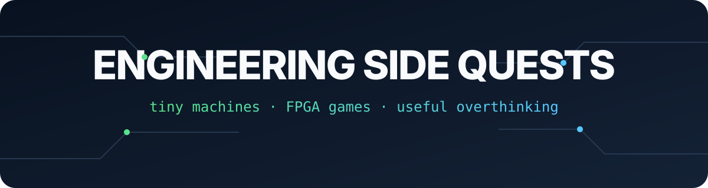

This is the less formal version of my engineering portfolio.

I study Computer Systems Engineering at Bath, which means I keep jumping between electronics, code, signals, mechanics and whatever breaks five minutes before the demo. The projects here are small on purpose. Together they show how I think: start with a real problem, learn the missing layer, build something, test it, then be honest about what still needs work.

> Not a folder of perfect coursework. More like a map of the rabbit holes I willingly entered.

## The good stuff

| Project | Why it exists | Layers crossed |
|---|---|---|
| [Universal IR Remote](./projects/universal-ir-remote.md) | We lost the Samsung remote. Buying one would have been suspiciously easy. | Embedded C++, IR protocols, MOSFET drive, KiCad, CAD, DFM |
| [Simon Says on an FPGA](./projects/simon-says-fpga.md) | To turn taught HDL building blocks into something interactive and slightly addictive. | SystemVerilog, FSMs, registers, timing, simulation, FPGA I/O |
| [Magnetic Track Mouse](./projects/magnetic-track-mouse.md) | Make a tiny vehicle follow a 20 kHz wire without panicking at every bend. | Analogue sensing, Arduino, proportional control, PWM, testing |

## More experiments, fewer dramatic names

- A four-layer stereo amplifier PCB combining analogue audio, switching power and ESP32 control, designed with a teammate.
- FIR filtering for a personalised amplitude-modulated signal in MATLAB.
- Heart-disease classification with an SVM, plus a separate neural-network study across regression, classification and unsupervised learning.
- A Python [ŌURA Smart Alarm Analyser](https://github.com/viggsss/oura-smart-alarm) with CSV and API data paths, a GUI and tested decision logic.
- A first pass at an AI-assisted golf recommendation product, because personalisation is more interesting than another static product list.

## A note on ownership

Some university projects were collaborative. I label them as collaborative and describe my own contribution. This repository contains edited case studies and selected visuals, not a dump of assessed submissions or somebody else's work.

## Tech that appears around here

`KiCad` `Arduino` `ESP32` `SystemVerilog` `Questa` `DE1-SoC` `MATLAB` `Python` `LTspice` `Capture CIS` `Autodesk Inventor`

If you want the more human version of me, it is on [viggogustafson.com](https://www.viggogustafson.com/).
