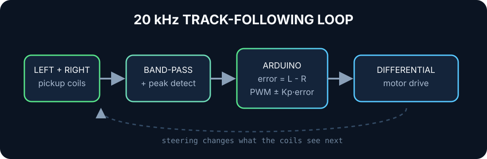

# Magnetic Track Mouse

Five of us had one project week to build an autonomous vehicle that followed a 20 kHz magnetic field produced by a wire beneath the track. I led the software and control work.

The two pickup coils feed analogue conditioning that turns the received signal into values the Arduino can compare. The controller calculates the left-right error and applies an asymmetric proportional correction to the two motor PWM commands.

## My part of the system

- Wrote the Arduino control loop and the averaging used to calm noisy ADC readings.
- Added a deadband so tiny sensor differences did not make the vehicle twitch.
- Tuned separate left and right gains because the physical platform was not perfectly symmetric.
- Measured an approximately 8% motor-speed mismatch with the tachometer and compensated through the base PWM values.
- Added a signal-loss fail-safe during iteration so bad sensing did not become full-speed confidence.
- Used serial traces and track tests to tune behaviour rather than guessing from code alone.

## The useful lesson

The clean equation is the easy part. Real motors, coils, batteries and mechanics are never twins. The controller became useful only after measurement exposed the asymmetry and the code acknowledged it.

This was collaborative hardware. I owned software and control, not the entire vehicle.
