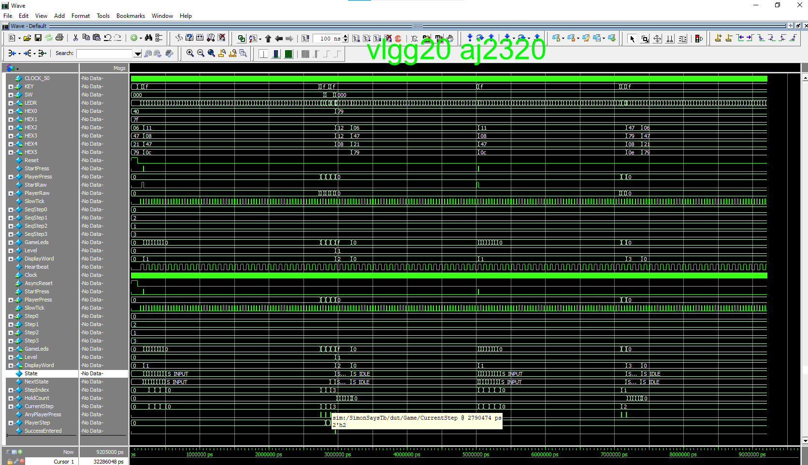

# Simon Says on an FPGA

This one started with a simple question: could the counters, registers and finite-state machines from the HDL labs become an actual game?

Built with a teammate, `FpgaSimonSays` is a self-contained memory game written in SystemVerilog for the Terasic DE1-SoC. The board displays a sequence, waits for the player to reproduce it through physical inputs, checks each step and increases the level after a correct round.

## What is inside

- A synchronous finite-state machine coordinating idle, display, input, validation, success and failure behaviour.
- Register-based sequence storage and a step index for comparing the player's input against the generated pattern.
- Clock-derived timing so human-visible LEDs and seven-segment displays coexist with deterministic internal logic.
- Simulation in Questa before hardware deployment, including state transitions, sequence output and player input.
- Direct FPGA I/O through the DE1-SoC switches, keys, LEDs and seven-segment displays.

## Why I like it

It is a small project, but it forced several abstract HDL ideas to cooperate in real time. A counter by itself is coursework. A counter controlling game timing while an FSM judges a human pressing physical buttons is a system.

## Honest next revision

I would separate the game controller, sequence generator, display driver and input conditioning into cleaner modules, add a self-checking testbench, and make metastability protection explicit at every asynchronous physical input.
