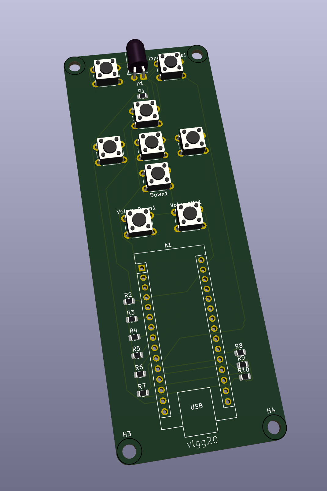
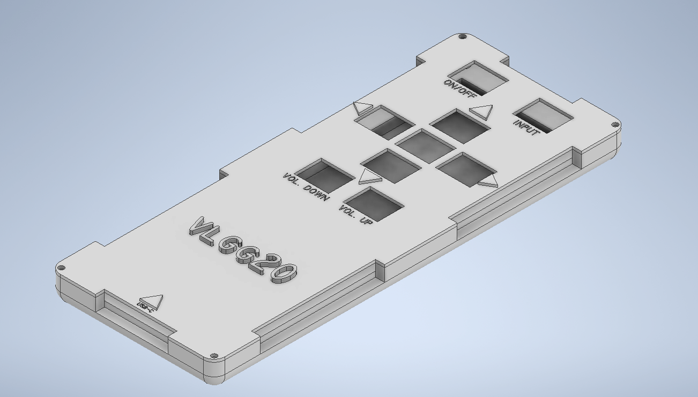

# Universal IR Remote

## The extremely avoidable origin story

The Samsung TV remote disappeared in my university flat. A normal person would order another one. I used it as an excuse to build a replacement from the protocol upwards.

The result was a portable ten-button remote based on an Arduino Nano ESP32. I captured the address and command structure from a working Samsung remote, mapped the controls in C++, drove the IR LED through a logic-level MOSFET, then moved the prototype from a chaotic breadboard into a custom two-layer PCB and CAD enclosure.

## What I actually did

- Captured the real Samsung IR protocol and command codes with an IR receiver instead of trusting random codes online.
- Implemented power, source, volume, menu and directional controls with separate behaviour for single-fire and held buttons.
- Added repeat logic for volume and navigation so the remote behaves like a remote, not a ten-button presentation clicker.
- Used an IRLZ44N MOSFET because the ESP32 GPIO could not deliver enough current for reliable range.
- Designed the schematic and PCB in KiCad with a ground plane, labelled silkscreen and enclosure-aware board outline.
- Modelled the base and cover in Autodesk Inventor, including button openings, USB-C access, IR clearance, fillets and embossed labels.
- Prepared the enclosure for additive manufacture in PrusaSlicer.

## The debugging bit

My first approaches included brute-force codes, online universal-code lists, a BJT driver and multiple IR LEDs. They were inconsistent or simply wrong. Capturing the actual protocol and fixing the current-drive problem changed the project from "sometimes flashes" to a reliable controller.

The working breadboard version controlled multiple Samsung TVs from up to roughly two metres. The PCB passed DRC, but it was not physically fabricated, so I treat enclosure fit and final board behaviour as designed, not verified.

## What I would change next

- Fabricate the PCB and print small enclosure tolerance coupons before the full case.
- Replace polling with interrupt-assisted input handling where it genuinely improves responsiveness.
- Add proper decoupling around high-current IR pulses and validate range with repeatable measurements.
- Shrink the board once the first physical revision proves the geometry.

[Watch the working prototype](https://www.youtube.com/watch?v=FkEC9mD5bbI)
